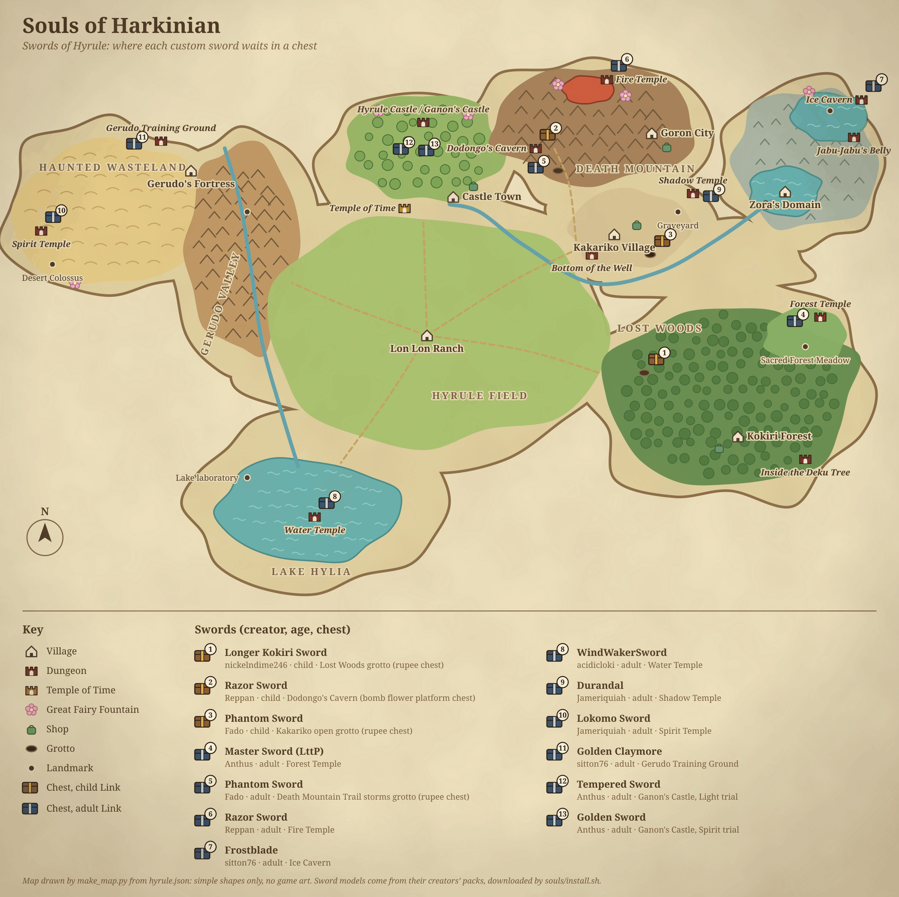

# Souls of Harkinian

A fork of [Ship of Harkinian](https://github.com/HarbourMasters/Shipwright) 9.3.1 with souls-style controls.
Everything is off until you apply the preset or turn on `gEnhancements.SoulsControls`.

## What it changes

- **Elden Ring controls and slots.** Right hand on R1 / R2, left hand (tools or a catalyst for spells) on L1, guard
  on L2, and the D-pad cycles your right hand, left hand, spell and quick item. You choose what goes in each slot on
  the new Equipment page. The full design is in [ER-SYSTEM.md](ER-SYSTEM.md).
- **Elden Ring style HUD.** A stone heart with HP and magic meters, your Spiritual Stones or Medallions top right, the
  slot cross bottom left and your rupees ("runes") bottom right.
- **Equipment page.** Slots for each hand, spells, arrows, shield, tunic, boots, up to 8 quick items and a 4-slot
  pouch. Weapon lists show a compare card before you equip.
- **Pouch.** Hold Triangle to see it, Triangle + D-pad uses that pouch item at once (ocarina, lens, boots, beans...).
- **Ocarina on Cross + D-pad.** Cross is the A note and the D-pad plays the C notes. Circle puts the ocarina away.
- **Epona like Torrent.** Put Epona in your quick items; Square plays her song for you and she comes.
- **Character creator.** Starting a new Vanilla or Master Quest file opens "Create Character" before the name entry:
  difficulty path, tunic, hair, boots and Navi colors, body size and sword blades, with a live preview of the real child
  and adult Link (L1 switches). Turn it off with `gEnhancements.SoulsCreator = 0`.
- **Each save file keeps its own look and path** (colors, body size, difficulty), stored in the save. An older save
  gets its slots filled once from what Link has equipped.

## Layout (PlayStation names)

| Button | Play | Menus |
|---|---|---|
| R1 | Right hand attack | Back (R1 + D-pad: put an item on that C button) |
| R2 | Tap: jump attack. Hold: spin attack | Back |
| L1 | Left hand: aim and fire a tool, or cast the spell with the catalyst | Next page |
| L2 | Guard with your shield | Previous page |
| Square | Quick item | |
| Triangle | Interact (tap). Hold: show the pouch. Triangle + D-pad: use a pouch item | Confirm (Equipment page: remove) |
| Cross | Jump. On the ocarina: A note | Confirm |
| Circle | Roll; hold to sprint. On the ocarina: put it away | Back |
| D-pad | Right: right hand. Left: left hand. Up: spell. Down: quick item. On the ocarina: C notes | Move cursor |
| R3 | Lock-on | |
| L3 / Create | First person / Navi | |
| Touchpad | Show or hide the minimap | |
| Options | Pause | Close |

## Install

1. **The game.** Souls of Harkinian is a build of Ship of Harkinian 9.3.1. Set it up like SoH: it needs your own
   Ocarina of Time ROM to create `oot.o2r` (and `oot-mq.o2r` for Master Quest). Nothing from the game is included here.
2. **The build.** Linux, Windows and macOS builds come from this repository's GitHub Actions
   ("generate-builds", artifacts `soh-linux`, `soh-windows`; signing in to GitHub is needed to download them).
3. **Start it once and close it**, so it creates its folder with `shipofharkinian.json`.
4. **Run the installer.** It copies the preset and downloads every dependency below:

   ```
   curl -fsSL https://raw.githubusercontent.com/iretonsean/souls-of-harkinian/souls/souls/install.sh | bash -s -- --soh "/path/to/your SoH folder"
   ```

   From a checkout: `bash souls/install.sh --soh "/path/to/your SoH folder"`. Add `--no-skins` to install only the preset.
   It needs `curl`, `unzip` and `python3` (and `7z` for packs shipped as .7z). Windows: run it in Git Bash or WSL.
5. **In the game**, open the menu, go to Settings > Presets and apply "Souls of Harkinian".

The preset also turns on the creator's gameplay settings (enemy health bars, improved roll, faster text, free camera
and more). `make_preset.py` rebuilds it from any `shipofharkinian.json`.

## Dependencies

Third-party packs are **not in this repository**: their authors' licenses don't allow redistribution. The installer
downloads them from GameBanana, the authors' own pages, onto your computer, and writes a `SOURCE.txt` with the
author and link next to each one. The list is `dependencies.json`.

### Weapon packs (installed into `souls-skins/`, not `mods/`)

The swords keep their creators' names in the game. They stay out of `mods/` on purpose: in `mods/` a pack would
replace the original sword for good. The Souls build loads them under their own names (roadmap step 2); until that
ships, they are downloaded but unused. `dependencies.json` lists which file of each pack is which sword.

| Sword in the game | Age | Pack | Author |
|---|---|---|---|
| Longer Kokiri Sword | child | [Longer Kokiri Sword](https://gamebanana.com/mods/664520) | nickelndime246 |
| Razor Sword | child, adult | [Razor Sword Collection](https://gamebanana.com/mods/597197) | Reppan |
| Phantom Sword | child, adult | [Phantom Sword](https://gamebanana.com/mods/689100) | Fado |
| Frostblade | adult | [Frostblade over Master Sword](https://gamebanana.com/mods/452111) | sitton76 |
| WindWakerSword | adult | [WindWakerSword](https://gamebanana.com/mods/728972) | acidicloki |
| Lokomo Sword | adult | [Lokomo Sword](https://gamebanana.com/mods/691194) | Jameriquiah |
| Master Sword (LttP), Tempered Sword, Golden Sword | adult | [Artwork Accurate LttP Master Sword 2.0](https://gamebanana.com/mods/703064) | Anthus |
| Durandal | adult | [Durandal over Biggoron's Sword](https://gamebanana.com/mods/594055) | Jameriquiah |
| Golden Claymore | adult | [Golden Claymore over Biggoron's Sword](https://gamebanana.com/mods/442039) | sitton76 |

### Where the swords are



Each sword waits in a chest. Child chests are brown, adult chests are blue. `map/hyrule.json` holds the
placements, and `python3 map/make_map.py` redraws the map (needs `rsvg-convert` for the
PNG). The map is drawn in code from simple shapes: it contains no art from the game.

| # | Sword | Creator | Age | Class | Chest |
|---|---|---|---|---|---|
| 1 | Longer Kokiri Sword | nickelndime246 | child | Kokiri | Lost Woods grotto (rupee chest) |
| 2 | Razor Sword | Reppan | child | Kokiri | Dodongo's Cavern (bomb flower platform chest) |
| 3 | Phantom Sword | Fado | child | Kokiri | Kakariko open grotto (rupee chest) |
| 4 | Master Sword (LttP) | Anthus | adult | Master | Forest Temple |
| 5 | Phantom Sword | Fado | adult | Master | Death Mountain Trail storms grotto (rupee chest) |
| 6 | Razor Sword | Reppan | adult | Master | Fire Temple |
| 7 | Frostblade | sitton76 | adult | Master | Ice Cavern |
| 8 | WindWakerSword | acidicloki | adult | Master | Water Temple |
| 9 | Durandal | Jameriquiah | adult | Biggoron | Shadow Temple |
| 10 | Lokomo Sword | Jameriquiah | adult | Master | Spirit Temple |
| 11 | Golden Claymore | sitton76 | adult | Biggoron | Gerudo Training Ground |
| 12 | Tempered Sword | Anthus | adult | Master | Ganon's Castle, Light trial |
| 13 | Golden Sword | Anthus | adult | Master | Ganon's Castle, Spirit trial |

### Optional, not installed automatically

- **PlayStation button icons:** [Xbox + PlayStation Style Controls](https://gamebanana.com/mods/462822) by trevvv.
  Its layouts follow the standard OoT controls, not the Souls layout, so some icons won't match. Use it as is or skip it.

## Code

- `soh/soh/Enhancements/controls/SoulsInput.cpp`: the layout switch and the jump.
- `soh/src/code/padmgr.c`: one call into it where the game reads the controller.
- `soh/soh/Enhancements/cosmetics/SoulsCreator.cpp`: the creator and its Link preview; hooks in
  `soh/src/overlays/gamestates/ovl_file_choose/z_file_choose.c`.
- `soh/soh/Enhancements/cosmetics/SoulsLook.cpp`: the per-save look and path.
- `souls/install.sh`, `souls/dependencies.json`: installer and the list of third-party packs.
